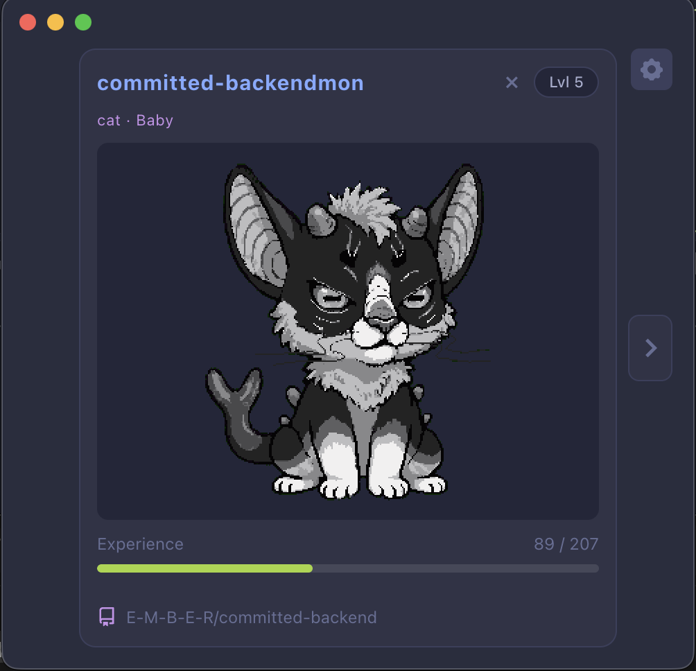

# Committed

Committed is a desktop virtual-pet game that turns your GitHub repositories into growing monsters. Choose a repository, pick an egg, and watch your companion hatch and evolve as your GitHub activity earns it experience.

Raise a collection of monsters, discover new forms, and unlock more egg designs along the way. Committed gives your coding progress a playful companion, making each contribution part of your monster's journey.

## Features

- **Unlockable eggs** - Unlock new egg designs as you progress.
- **Multiple color themes** - Choose a look that suits your style.
- **Sacrifice monsters** - Gives you points to unlock more monsters. Resets your progress on a repo.

[Look here for latest release.](https://github.com/E-M-B-E-R/committed/releases)

## AI Disclaimer
This project uses AI in the following ways:
* To generate code, fix defects, and code reviews.
* Generate PR descriptions and sometimes release notes.
* To generate pixel art and pixel art animations.
* To generate monster designs where there are gaps.

Each monster is based off a real illustration made by an artist (me) and converted into pixel art using AI and animated using AI tools. Eggs, baby forms, and adult forms may or may not be AI generated, but are based off of illustrations and monster designs painted by the artist. Backgrounds are purely AI generated.

The goal is to migrate off of as much AI art as possible as the game development progresses, but conversion into pixel art and animation will likely continue to be AI generated.

## Copyright

Copyright (c) 2026 E-M-B-E-R.
